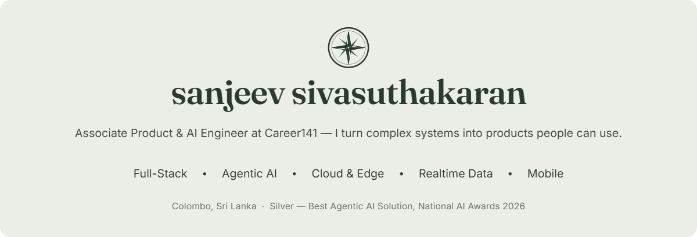
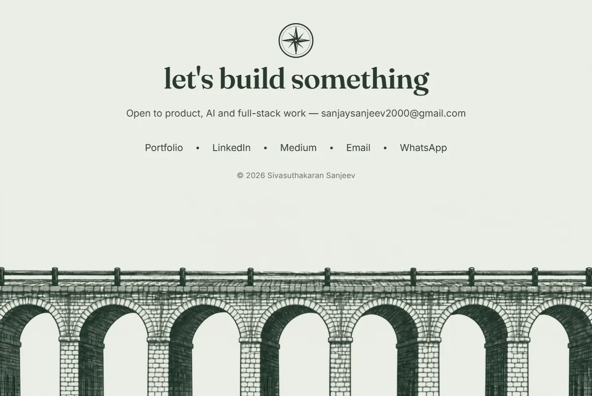

<a href="https://sanjeev200009.github.io/Sivasuthakaran-Sanjeev-Portfolio/">Portfolio</a> &nbsp;·&nbsp;
<a href="https://www.linkedin.com/in/sanjeevsiva/">LinkedIn</a> &nbsp;·&nbsp;
<a href="https://medium.com/@sanjaysanjeev2000">Medium</a> &nbsp;·&nbsp;
<a href="mailto:sanjaysanjeev2000@gmail.com">Email</a> &nbsp;·&nbsp;
<a href="https://wa.me/94722858346">WhatsApp</a>

## about

I'm an **Associate Product & AI Engineer at [Career141](https://career141.com/)** in Colombo, Sri Lanka. I build production AI pipelines, cloud infrastructure and full-stack products, and I care most about turning complex systems into things people can actually use.

| AI pipelines | Infrastructure | Recognition |
| :--: | :--: | :--: |
| **115K** profiles processed | **78%** cost reduction | **Silver** — Best Agentic AI Solution, National AI Awards 2026 |

**Career flow** &nbsp; Coding foundation → Freelance developer → Web Developer Intern, Career141 → **Associate Product & AI Engineer, Career141** *(current)*

## featured work

### AURA — AI Unified Recruitment Agent
*Award-winning private product* · 🥈 Silver — Best Agentic AI Solution, National AI Awards 2026
An agentic recruitment platform that brings candidate screening, evaluation and interview workflows into one unified system.
`OpenAI` `Node.js` `Convex` `AWS` `Redis / BullMQ`

### MailGrid — Enterprise Email Infrastructure
*Private product* · **78% cost reduction** · **84,085 contacts**
A high-throughput email delivery platform built to cut infrastructure cost while keeping large contact operations manageable.
`AWS SES` `Amazon SNS` `Express.js` `Prisma ORM` `MariaDB`

### Released live work

| Project | What it is | Stack |
| :-- | :-- | :-- |
| [**Career141.com**](https://career141.com/) | Career141's live platform: global executive search, recruitment expertise, culture and opportunities | Next.js · TypeScript · Tailwind CSS · Cloudflare · Supabase |
| [**VOTA**](https://vota.career141.com/) | A released Career141 product with a focused, production-ready experience | Node.js · Express.js · PostgreSQL · Supabase · Cloudflare |
| [**Talent Unwrapped**](https://talentunwrapped.career141.com/) | Turns talent information into a polished, shareable digital story | Node.js · Express.js · PostgreSQL · Supabase · Cloudflare |

<b>Earlier builds</b>

 

| Project | What it is | Stack |
| :-- | :-- | :-- |
| [Zero Hunger Mobile App](https://github.com/sanjeev200009/zero-hunger-mobile-app) | Connects food donors with communities in need (SDG 2), with real-time maps and secure auth | Android Studio · Java |
| [Academic Risk Prediction](https://github.com/sanjeev200009/academic-risk-prediction) | Predicts students at risk in Sri Lankan schools — 82% accuracy on 1,500+ records | Python · Streamlit · Scikit-learn |
| [School Management System](https://github.com/sanjeev200009/school-management-system) | Desktop app for students, staff, marks and results — cut admin workload by 40% | Java · JavaFX · MySQL |
| QuickCart — [API](https://github.com/sanjeev200009/quickcart-api) · [App](https://github.com/sanjeev200009/quickcart-mobile) | Hackathon mobile e-commerce app with a Node.js payments API | React Native · Node.js · MongoDB |
| [E-Commerce App](https://github.com/sanjeev200009/ecommerce-app) · [Review Filter](https://github.com/sanjeev200009/review-filter) · [30 Days React](https://github.com/sanjeev200009/30-days-react) | React front-end projects and a 30-project React challenge | React · TypeScript · Tailwind CSS |

## engineering capabilities

**Full-stack web & mobile** — accessible web apps and cross-platform mobile with strict TypeScript, server components, fluid motion and production SEO.
      

**Autonomous AI & LLM pipelines** — multi-agent screening and evaluation, speech-to-text and vector search.
    

**Cloud infrastructure & edge** — serverless, email at scale and edge delivery.
    

**Databases, realtime & queues** — hot/cold storage tiering, background queues, reactive sync and ACID PostgreSQL schemas.
      

## education

- **BIT (Hons) in Network & Mobile Computing** — Horizon Campus
- **Web Development Training** — University of Moratuwa (2024)
- **A/L in Engineering Technology** — Methodist Central College, Batticaloa (2020)

## references

**Mr. Yathurshan Pathmanathan** — Software Engineer, Niftron (Pvt) Ltd
📱 +94 758372238 · 📧 yathurshanpathmanathan@gmail.com

## on github

 

 

<a href="https://sanjeev200009.github.io/Sivasuthakaran-Sanjeev-Portfolio/">Portfolio</a> &nbsp;·&nbsp;
<a href="https://www.linkedin.com/in/sanjeevsiva/">LinkedIn</a> &nbsp;·&nbsp;
<a href="https://medium.com/@sanjaysanjeev2000">Medium</a> &nbsp;·&nbsp;
<a href="mailto:sanjaysanjeev2000@gmail.com">Email</a> &nbsp;·&nbsp;
<a href="https://wa.me/94722858346">WhatsApp</a>

