

<a href="https://sanjeev200009.github.io/Sivasuthakaran-Sanjeev-Portfolio/"></a>

<a href="#work"></a>

<a href="#work"></a>

<a href="#work"></a>

<a href="https://career141.com/"></a> <a href="https://vota.career141.com/"></a> <a href="https://talentunwrapped.career141.com/"></a>

<a href="#work"></a> <a href="#work"></a>

<b>&nbsp;Earlier builds</b> — open-source projects from before Career141

 

| Project | What it is | Stack |
| :-- | :-- | :-- |
| [Zero Hunger Mobile App](https://github.com/sanjeev200009/zero-hunger-mobile-app) | Connects food donors with communities in need (SDG 2), with real-time maps and secure auth | Android Studio · Java |
| [Academic Risk Prediction](https://github.com/sanjeev200009/academic-risk-prediction) | Predicts students at risk in Sri Lankan schools — 82% accuracy on 1,500+ records | Python · Streamlit · Scikit-learn |
| [School Management System](https://github.com/sanjeev200009/school-management-system) | Desktop app for students, staff, marks and results — cut admin workload by 40% | Java · JavaFX · MySQL |
| QuickCart — [API](https://github.com/sanjeev200009/quickcart-api) · [App](https://github.com/sanjeev200009/quickcart-mobile) | Hackathon mobile e-commerce app with a Node.js payments API | React Native · Node.js · MongoDB |
| [E-Commerce App](https://github.com/sanjeev200009/ecommerce-app) · [Review Filter](https://github.com/sanjeev200009/review-filter) · [30 Days React](https://github.com/sanjeev200009/30-days-react) | React front-end projects and a 30-project React challenge | React · TypeScript · Tailwind CSS |

<a href="#capabilities"></a> <a href="#capabilities"></a> <a href="#capabilities"></a> <a href="#capabilities"></a>

<a href="#journey"></a>

<b>&nbsp;References</b>

 

**Mr. Yathurshan Pathmanathan** — Software Engineer, Niftron (Pvt) Ltd
📱 +94 758372238 · 📧 yathurshanpathmanathan@gmail.com

<a href="https://sanjeev200009.github.io/Sivasuthakaran-Sanjeev-Portfolio/">Portfolio</a> &nbsp;·&nbsp;
<a href="https://www.linkedin.com/in/sanjeevsiva/">LinkedIn</a> &nbsp;·&nbsp;
<a href="https://medium.com/@sanjaysanjeev2000">Medium</a> &nbsp;·&nbsp;
<a href="mailto:sanjaysanjeev2000@gmail.com">Email</a> &nbsp;·&nbsp;
<a href="https://wa.me/94722858346">WhatsApp</a>

